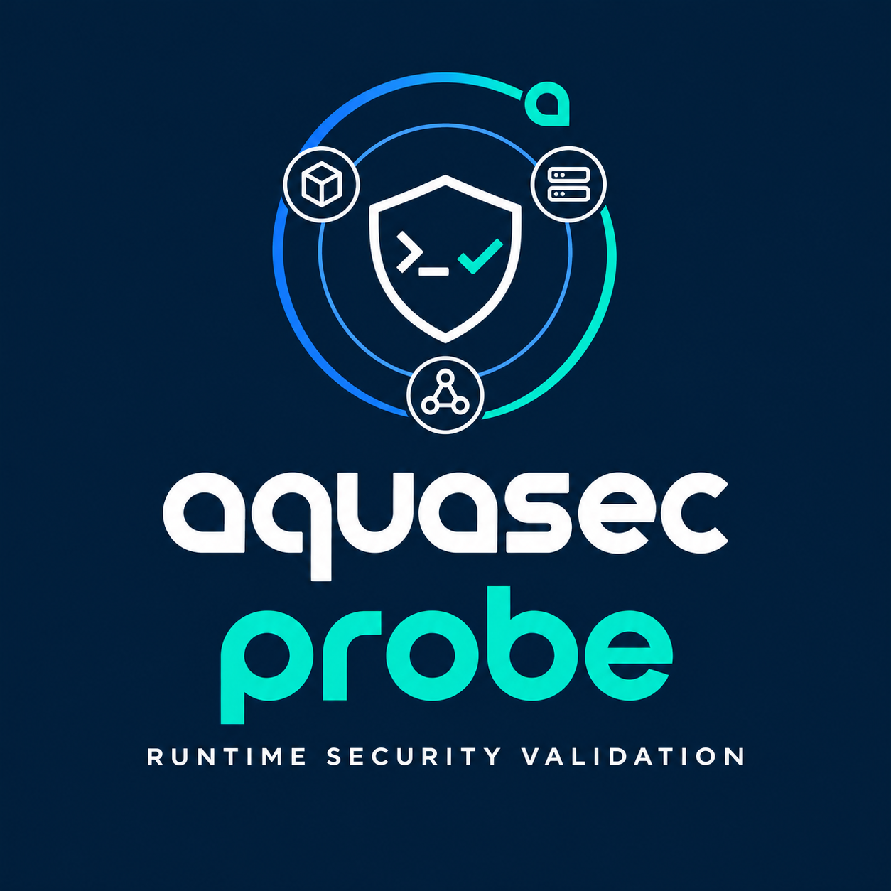
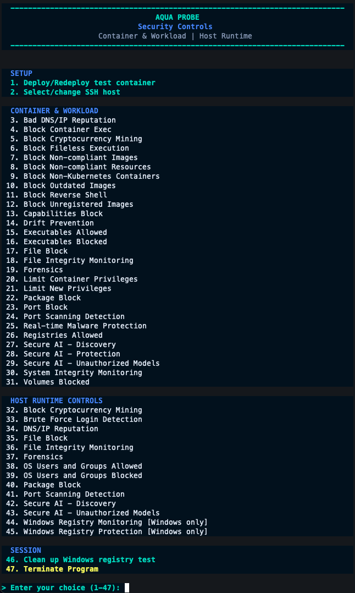

<p align="center">
  
</p>

<h1 align="center">Aqua Probe</h1>

<p align="center">
  <strong>Repeatable runtime security validation for Kubernetes and hosts.</strong><br>
  Guided tests that connect policy configuration, runtime activity, and evidence in Aqua.
</p>

<p align="center">
  <a href="aqua-probe.sh"></a>
  <a href="#capabilities"></a>
  <a href="tests"></a>
</p>

<p align="center">
  <a href="#quick-start">Quick start</a> &middot;
  <a href="#capabilities">Capabilities</a> &middot;
  <a href="#see-aqua-probe-in-action">Walkthrough</a> &middot;
  <a href="docs/control-reference.md">Control reference</a> &middot;
  <a href="#documentation">Documentation</a>
</p>

---

## Validate With Context

Aqua Probe is an interactive Bash tool for exercising Aqua runtime security controls in a lab. It guides you through policy prerequisites, test activity, and evidence review across Kubernetes workloads and explicitly selected Linux or Windows hosts over SSH.

Use it to structure customer workshops, Compass classes, technical enablement, demos, and proofs of value: select a control, explain the expected behavior, run the test, and review what actually happened. Policies are configured by the operator; Aqua Probe does not automatically create or restore Aqua policies.

This repository does not establish Aqua Probe as an officially supported Aqua Security product.

## See Aqua Probe in Action

### One Menu, Two Runtime Scopes

Setup, container/workload controls, host controls, and session cleanup are grouped in a single terminal menu. Select a control to follow its policy prerequisites, test steps, and evidence-review guidance.

<p align="center">
  <a href="misc/aqua-probe-advanced-commands.png">
    
  </a>
</p>

<p align="center"><em>Current terminal menu, captured November 2, 2026. Select the image for the full-size view.</em></p>

<details>
<summary><strong>Watch the terminal walkthrough</strong> &middot; 48 seconds</summary>

Recorded November 2, 2026. Expand to view the demo; collapse to keep the page still while reading.

<p align="center">
  <a href="misc/aqua-probe-demo.gif">
    
  </a>
</p>

[Open the full-size demo](misc/aqua-probe-demo.gif). This recording illustrates a lab session, not a guarantee of detection in another environment. Review the [safety guidance](#lab-safety-and-cleanup) before testing.

</details>

## Capabilities

| Area | Guided validation |
| --- | --- |
| Images and admission | Non-compliant, outdated, and unregistered images; allowed registries; non-compliant resources; non-Kubernetes containers |
| Execution and privileges | Container exec, fileless execution, reverse shell, drift prevention, executable allow/block rules, capabilities, container privileges, and new privileges |
| Files and visibility | File and package blocking, file integrity monitoring, forensics, real-time malware protection, and container system integrity |
| Network and storage | DNS/IP reputation, cryptocurrency mining, port blocking and scanning, and volumes |
| Host Runtime Policies | Shared Linux signatures over SSH, bounded brute-force login tests, and user/group authentication allow/block tests on Linux or Windows |
| Windows registry | Monitoring and protection over SSH/PowerShell; requires Windows Aqua Enforcer |
| Secure AI | Discovery and unauthorized-model tests for container and host workflows; container-app Prompt Protection testing for Aqua SaaS tenants only |

Container/workload controls and Host Runtime Policies are separate scopes. Shared commands do not make policies interchangeable. Windows support is control-specific; Linux test commands are not sent to Windows hosts.

The [complete control reference](docs/control-reference.md) documents menu options, policy settings, test coverage, and limitations. Not every platform option has an automated test.

### A Repeatable Workflow

| Step | Operator action | Evidence to retain |
| --- | --- | --- |
| **1. Select** | Choose the lab cluster or SSH host and a control. | Target identity and policy scope |
| **2. Prepare** | Read prerequisites, configure the policy, and confirm synchronization. | Policy settings and baseline |
| **3. Exercise** | Run the displayed command or deploy the test workload. | Output and test time |
| **4. Review** | Check **Security Reports -> Audit**, AI Findings, or forensic activity. | Matching target, policy, and event |
| **5. Clean up** | Use cleanup/termination options and restore policies manually. | Remaining resources and recovery status |

A nonzero exit code is not proof of enforcement. Missing tools, image-pull failures, admission rules, permissions, and connection errors can look similar. Forensics and allowed-operation tests may produce telemetry without a security incident.

## Lab Safety and Cleanup

> [!WARNING]
> Use only authorized, disposable lab environments. These are real commands and deployments, not a dry-run simulator. Reserve the entire `aqua-probe-lab` namespace for this tool.

- **Real changes:** tests can deploy privileged workloads, create cluster-scoped RBAC resources, make external network requests, scan ports, and generate authentication failures. Cluster-scoped tests are not namespace-isolated.
- **Sensitive operations:** container file-integrity testing modifies permissions and deletes `/etc/sudoers` inside the test container. System-integrity testing attempts to change the clock; sufficient privileges can affect the host. Never use production targets.
- **Cleanup scope:** main-menu **Terminate Program** removes known test resources, named cluster roles/bindings, the entire `aqua-probe-lab` namespace, and the local Docker test container when Docker is available. Some deletion is asynchronous; verify completion. Do not share these names with unrelated resources.
- **Host recovery:** retain independent administrator and out-of-band access for authentication tests. Windows registry cleanup may require removing the test path from protection first. Interrupted sessions or blocked cleanup can require manual recovery.
- **Secrets and costs:** Secure AI needs your own OpenAI credentials and model access and may incur charges. The container app uses a Kubernetes Secret; restrict access to it and the app's LoadBalancer endpoint. Never commit credentials.

Audit/authentication records remain after cleanup. Aqua policy changes are never restored automatically. See [host cleanup and recovery details](docs/control-reference.md#host-runtime-policies).

## Prerequisites

| Workflow | Requirements |
| --- | --- |
| Local CLI | Bash, Git to clone the repository, and a terminal |
| Kubernetes | Configured `kubectl` context; Aqua Enforcer DaemonSet and `aqua-kube-enforcer` deployment; permissions for selected tests and cleanup; registry access |
| Linux host | SSH access to an authorized host with Linux Aqua Enforcer, Bash, and the utilities needed by the selected test |
| Windows host | Windows Aqua Enforcer, Windows OpenSSH Server, Windows PowerShell 5.1+; local `ssh` and `python3` for registry tests |
| Secure AI | Feature availability for the target/tenant, API credentials and model access; native Python 3 for host requests |
| Docker-only test | Run on the intended worker host with access to a compatible Docker runtime; Kubernetes access alone is insufficient |

Kubernetes startup checks confirm connectivity and resource existence, not Enforcer readiness or policy health. Confirm coverage in Aqua before testing.

The host selector lists Windows Server 2019, 2022, and 2025. Consult official Aqua system requirements documentation for the current Windows and Linux support matrix; the script does not perform OS-version compatibility checks.

## Quick Start

Clone and inspect the options without contacting a cluster:

```bash
git clone https://github.com/ericgomes56/aqua-probe.git
cd aqua-probe
chmod +x aqua-probe.sh
./aqua-probe.sh --help
```

### Kubernetes Workloads

Confirm that the active context points to your lab, then launch:

```bash
kubectl config current-context
./aqua-probe.sh
```

Choose **Deploy/Redeploy test container**, then a control. Follow its prerequisites before running the test. The default image is `ericgomes56/aqua-probe:2.0`; deployment prompts support custom images where applicable.

### Hosts Over SSH

Skip Kubernetes startup checks:

```bash
./aqua-probe.sh --host-runtime
```

Choose **Select/change SSH host**, select Linux or Windows, then enter the hostname, username, port, and optional local private-key path. Connections are retained separately per OS for the session.

Host-only **0** exits without unrelated Kubernetes/Docker cleanup, but retries pending Windows registry cleanup. Read the [host prerequisites and recovery instructions](docs/control-reference.md#host-runtime-policies) before testing.

## Common Usage

```bash
# Explicit default test image
./aqua-probe.sh --image ericgomes56/aqua-probe:2.0

# Plain-text host-only interface
NO_COLOR=1 ./aqua-probe.sh --host-runtime

# Skip prerequisites only for container controls that support this flag
./aqua-probe.sh --no-instructions --image ericgomes56/aqua-probe:2.0
```

For a private registry, pass its actual pullable image reference to `--image`. The image must contain the utilities required by the selected control. Secure AI uses `ericgomes56/ai-app:1.0` and the non-compliant-image test uses `jerbi/eicar:latest`; these are fixed-image exceptions.

For local builds, match the **Kubernetes worker architecture**, not just your laptop. The [image build guide](Dockerfile/README.md) covers Linux AMD64/ARM64, dependencies, and build caveats.

## Configuration

| Option | Behavior |
| --- | --- |
| `--help`, `-h` | Print options and exit without Kubernetes checks |
| `--host-runtime` | Open the host-only interface |
| `--image IMAGE`, `-i IMAGE` | Default test image; initially `ericgomes56/aqua-probe:2.0` |
| `--namespace NAME`, `-ns NAME` | **Aqua Enforcer** namespace; default `aqua`. Does not change `aqua-probe-lab`. |
| `--daemonset NAME`, `-ds NAME` | Custom Enforcer DaemonSet name; built-in names are checked first |
| `--no-instructions`, `-n` | Skip supported container prerequisites; host and other guarded workflows still require confirmation |
| `--version`, `-v` | Print the embedded build date, then continue startup; not an exit-only command |
| `NO_COLOR=1` | Disable colors; redirected output and `TERM=dumb` also omit color codes |

The CLI initializes image and namespace defaults at startup. Use flags rather than relying on pre-exported values for those settings.

## Documentation

| Resource | Purpose |
| --- | --- |
| [Control reference](docs/control-reference.md) | Full menu, policy instructions, host setup, platform differences, and evidence checks |
| [PDF user guide](user-guide/Aqua-Probe_Userguide.pdf) | Illustrated setup, current menu, container and host workflows, Secure AI, and cleanup guidance; updated November 2, 2026 |
| [Container image build guide](Dockerfile/README.md) | Dependencies, architecture selection, and troubleshooting |
| [Source script](aqua-probe.sh) | Current commands, manifests, prompts, and cleanup behavior |
| [Offline test suites](tests) | Mocked workflows, routing, cleanup, startup checks, and terminal formatting |
| [Rebranding summary](SUMMARY_REPORT.md) | Historical migration notes |

## Contributing and Support

When reporting a problem to the repository maintainer, include the control name, target platform, policy mode, expected behavior, and sanitized command output. Remove API keys, private keys, tokens, and customer information. For Aqua platform support, use your organization's normal Aqua support channel.

Keep changes scoped and include offline tests for workflow changes. Run from the repository root:

```bash
bash -n aqua-probe.sh
for test in tests/test-*.sh; do
  bash "$test" || break
done
```

The suites use mocks, not live Aqua enforcement. Check their local dependencies; PowerShell syntax validation requires `pwsh`. Live validation belongs in a monitored, authorized lab.

**License:** no license file is currently included. Clarify licensing with the maintainer before reuse or redistribution.

## Credit

Aqua Probe is a maintained fork and evolution of Aqua Warden. The project has been rebranded and is actively developed to support Aqua runtime security testing, PoVs, and technical enablement.
